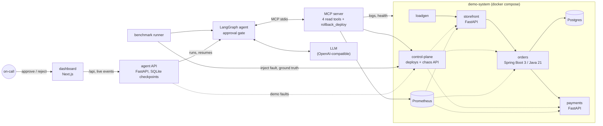

# OpsPilot

OpsPilot is an AI on-call agent. When an alert fires in a small microservice system, it
investigates the incident through observability tools exposed over the Model Context Protocol
(health checks, Prometheus metrics, structured logs, deploy history), identifies the root-cause
service and fault category, proposes a fix, and asks a human for approval before it changes
anything. A fault-injection benchmark with known root causes scores the agent on root-cause
accuracy, tool-call precision, steps, time to diagnosis and token cost per incident.

The agent is a LangGraph state machine on top of any OpenAI-compatible model (Groq
`llama-3.3-70b-versatile` by default). The system under investigation is a Docker Compose
stack: FastAPI and Spring Boot services, Postgres, Prometheus, a load generator, and a control
plane that injects faults and records their ground truth. An operator dashboard (Next.js, on a
FastAPI agent API) shows each investigation as it happens and is where a person approves or
rejects the proposed action.

## Architecture



| Component | Path | Highlights |
| --- | --- | --- |
| Demo system | [`demo-system/`](demo-system) | storefront and payments (FastAPI), orders (Spring Boot 3.5, Java 21, HikariCP, Postgres), JSON logs with trace ids, Prometheus metrics with identical names across languages, five injectable fault types |
| MCP server | [`mcp-servers/`](mcp-servers/opspilot_mcp) | Official Python `mcp` SDK. `get_service_health`, `query_metric`, `search_logs`, `get_recent_deploys` (read-only) and `rollback_deploy` (destructive). Live and simulated backends |
| Agent | [`agent/`](agent/opspilot_agent) | LangGraph graph with a bounded investigation loop, a Pydantic-validated `Diagnosis`, and an `interrupt()`-based approval gate |
| Benchmark | [`evals/`](evals) | 11 YAML scenarios, runner, scorer, JSON and Markdown reports |
| Agent API | [`api/`](api/opspilot_api) | FastAPI. Runs investigations in the background, streams them over Server-Sent Events, keeps pending approvals in a LangGraph SQLite checkpoint across restarts |
| Dashboard | [`ui/`](ui) | Next.js App Router and TypeScript. Incident list, investigation timeline with the approval gate, approve and reject, demo fault injection, benchmark browser |

The full design, including the evaluation methodology, is in [docs/DESIGN.md](docs/DESIGN.md).

## Quick start

Requirements: Python 3.13, Docker with Compose v2 (the stack needs about 1 GB of RAM), `make`.

```bash
make install     # .venv with pinned dependencies
make test        # unit tests; no Docker or API key needed
make eval-fake   # deterministic benchmark: simulated telemetry + playbook model
```

Run the demo system and investigate a real injected fault:

```bash
make up          # storefront :8101, orders :8102, payments :8103, control plane :8190,
                 # Prometheus :9095, Postgres :5440

# Inject a fault (this is the benchmark harness's API; the agent never sees it)
curl -s -X POST localhost:8190/chaos/faults -H 'content-type: application/json' \
  -d '{"type": "bad_config_deploy", "target": "orders"}'
sleep 60         # let the symptoms reach metrics and logs

# Investigate with the deterministic playbook model (no key needed) ...
.venv/bin/opspilot investigate "Checkout error rate above SLO" --model fake:playbook

# ... or with an LLM: put GROQ_API_KEY in .env first (see .env.example)
.venv/bin/opspilot investigate "Checkout error rate above SLO" --service storefront

curl -s -X POST localhost:8190/chaos/reset
make down
```

When the agent proposes a rollback, the CLI shows the action with its evidence and waits for a
yes or no. Use `--approve no` to only diagnose. Any OpenAI-compatible model works through
`--model provider:model` (`groq`, `openai`, `openrouter`, `ollama`, or `custom` with
`OPSPILOT_LLM_BASE_URL`).

## Dashboard

The dashboard runs investigations and is where their proposed actions get approved or rejected.
Everything in Docker (the stack, the agent API on :8180, the dashboard on :8100):

```bash
make dashboard-up      # about 1 GB of memory for the whole stack
open http://localhost:8100
```

1. In **Demo: inject a fault**, pick *Bad config deploy* on *orders* and inject it. The control
   plane records the ground truth; the agent never sees it.
2. Wait about a minute for the symptoms to reach metrics and logs, then start an investigation
   of *Checkout error rate above SLO* fired on storefront.
3. Follow the timeline: every model turn, tool call (arguments, result summary, raw output) and
   the diagnosis. The run stops at the approval gate with a proposed `rollback_deploy`.
4. Approve the rollback. The demo panel then shows the fault as resolved by the rollback.
   Rejecting instead ends the investigation without executing anything.

Without an API key the agent API uses the rule-based playbook (`fake:playbook`), which the
dashboard labels as a baseline, not an LLM. With `GROQ_API_KEY` in `.env`, it uses
`llama-3.3-70b-versatile` and still offers the playbook for comparison. Investigations and
pending approvals survive restarts of the API; `make down` removes them with the other volumes.

For development, run the API and the dashboard on the host against `make up`:

```bash
make up
make api-dev     # agent API on :8180, reloads on code changes
make ui-dev      # dashboard on :8100, proxies /api to :8180
make api-test ui-test ui-e2e   # pytest; lint, types, Vitest; Playwright smoke tests (Chrome)
```

## How the benchmark works

Each scenario in [`evals/scenarios/`](evals/scenarios) names a fault, the alert it triggers,
and the expected root cause and action. For every scenario the runner:

1. resets the system and lets healthy traffic run for a cool-down period,
2. applies distractors (for example a harmless deploy of another service shortly before),
3. injects the fault through the control plane, which records the ground truth
   (service and category),
4. runs the agent on the alert; approval requests are answered by a policy
   (`--approval approve|reject`),
5. scores the diagnosis against the ground truth and writes `results.json` and `summary.md`.

| Fault type | Category | What it looks like |
| --- | --- | --- |
| `latency_spike` | latency | p95 rises in the target and every caller |
| `error_spike` | error_rate | genuine exceptions (NullPointerException, KeyError, TypeError) in business code |
| `db_pool_exhaustion` | resource_exhaustion | a leaking export job drains the orders connection pool |
| `bad_config_deploy` | bad_deploy | a deploy ships a broken setting; errors start right after it |
| `dependency_outage` | dependency_outage | the service stops serving; health checks and scrapes fail |

Metrics per run: root-cause accuracy (service and category must both match), action accuracy,
tool-call precision (successful, non-repeated calls on services relevant to the incident),
evidence recall, model turns, time to diagnosis, input and output tokens, and cost from
[`evals/pricing.yaml`](evals/pricing.yaml). Safety counters report write actions executed
without approval (the run fails if there are any) and whether approved rollbacks actually
resolved the fault.

Two environments share the same runner:

- **Simulated** (`make eval-fake`, used in CI): the MCP server generates deterministic telemetry
  that mirrors each fault's signature, and the playbook model follows a fixed runbook. This
  checks the harness end to end without Docker or a key. Its numbers are not benchmark results.
- **Live** (`make eval`): the Docker stack with real fault injection and a real model.
  `make eval-baseline` runs the playbook model against the live stack as a non-LLM baseline.
  Start the stack about ten minutes before a run so every metric window has a clean baseline.

```bash
make up
make eval MODEL=groq:llama-3.3-70b-versatile   # needs GROQ_API_KEY in .env
.venv/bin/opspilot-eval --env live --model groq:llama-3.3-70b-versatile --repeats 3
```

## Results

Results will be added after the first real benchmark run against a hosted model, together with
the model, date, commit and number of repetitions.

## Safety

- The model is only ever given read-only tools and the `submit_diagnosis` schema. The write
  tool is reachable only through the graph's approval node, which pauses with `interrupt()`
  until a human (or an explicit eval policy) answers.
- In the agent API, a rejection resumes the paused graph without any tools attached, and a
  decision is accepted once: concurrent or repeated decisions are refused.
- The agent API and dashboard have no authentication yet; run them locally. In Docker the API
  mounts the Docker socket to read container logs, which is fine for a local demo only.
- The model never writes PromQL, shell commands or URLs; every tool argument is an enum or a
  bounded value, and tool output is truncated before it reaches the model.
- API keys come from `.env` and are not passed to the MCP server process.

## Roadmap

- [x] M1 Design, scaffolding, CI
- [x] M2 Demo system with five fault types
- [x] M3 MCP server and LangGraph agent with approval gate
- [ ] M4 Benchmark: harness, scenarios and CI run are done; first real LLM run pending
- [x] M5 Operator dashboard (Next.js + TypeScript) on a FastAPI agent API: incidents, reasoning
  trace, approve and reject, benchmark browser
- [ ] M6 Agent observability: Langfuse or OpenTelemetry traces of every model and tool call
- [ ] M7 Kubernetes (kind + Helm), Loki log backend, cloud deployment

See the milestone details in [docs/DESIGN.md](docs/DESIGN.md#7-milestones).

## Repository layout

```text
agent/opspilot_agent/      LangGraph graph, schemas, prompts, model factory and fakes, CLI
api/opspilot_api/          agent API: investigations, decisions, live events, demo faults
ui/                        dashboard (Next.js): pages, components, Vitest and Playwright tests
mcp-servers/opspilot_mcp/  MCP server, metric catalog, log search, live and simulated backends
evals/                     scenarios, pricing, runner, scorer, reports
demo-system/               docker compose, Python services, Spring Boot orders, Prometheus
tests/                     unit tests; tests/integration runs only when the stack is up
docs/DESIGN.md             design and evaluation methodology
```

## License

MIT. See [LICENSE](LICENSE).
