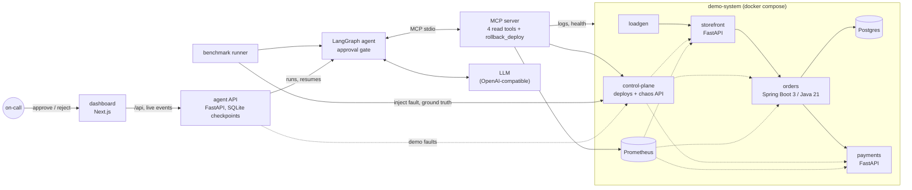

# OpsPilot

OpsPilot is an AI on-call agent. When an alert fires in a small microservice system, it
investigates the incident through observability tools exposed over the Model Context Protocol
(health checks, Prometheus metrics, structured logs, deploy history), identifies the root-cause
service and fault category, proposes a fix, and asks a human for approval before it changes
anything. A fault-injection benchmark with known root causes scores the agent on root-cause
accuracy, tool-call precision, steps, time to diagnosis and token cost per incident.

The agent is a LangGraph state machine on top of any OpenAI-compatible model (Groq
`openai/gpt-oss-120b` by default). The system under investigation is a Docker Compose
stack: FastAPI and Spring Boot services, Postgres, Prometheus, a load generator, and a control
plane that injects faults and records their ground truth. An operator dashboard (Next.js, on a
FastAPI agent API) shows each investigation as it happens and is where a person approves or
rejects the proposed action.

## Architecture



| Component | Path | Highlights |
| --- | --- | --- |
| Demo system | [`demo-system/`](demo-system) | storefront and payments (FastAPI), orders (Spring Boot 3.5, Java 21, HikariCP, Postgres), JSON logs with trace ids, Prometheus metrics with identical names across languages, five injectable fault types |
| MCP server | [`mcp-servers/`](mcp-servers/opspilot_mcp) | Official Python `mcp` SDK. `get_service_health`, `query_metric`, `search_logs`, `get_recent_deploys` (read-only) and `rollback_deploy` (destructive). Live and simulated backends |
| Agent | [`agent/`](agent/opspilot_agent) | LangGraph graph with a bounded investigation loop, a Pydantic-validated `Diagnosis`, and an `interrupt()`-based approval gate |
| Benchmark | [`evals/`](evals) | 26 YAML scenarios, runner, scorer, JSON and Markdown reports |
| Agent API | [`api/`](api/opspilot_api) | FastAPI. Runs investigations in the background, streams them over Server-Sent Events, keeps pending approvals in a LangGraph SQLite checkpoint across restarts |
| Dashboard | [`ui/`](ui) | Next.js App Router and TypeScript. Incident list, investigation timeline with the approval gate, approve and reject, demo fault injection, benchmark browser |

The full design, including the evaluation methodology, is in [docs/DESIGN.md](docs/DESIGN.md).

## Quick start

Requirements: Python 3.13, Docker with Compose v2 (the stack needs about 1 GB of RAM), `make`.

```bash
make install     # .venv with pinned dependencies
make test        # unit tests; no Docker or API key needed
make eval-fake   # deterministic benchmark: simulated telemetry + playbook model
```

Run the demo system and investigate a real injected fault:

```bash
make up          # storefront :8101, orders :8102, payments :8103, control plane :8190,
                 # Prometheus :9095, Postgres :5440

# Inject a fault (this is the benchmark harness's API; the agent never sees it)
curl -s -X POST localhost:8190/chaos/faults -H 'content-type: application/json' \
  -d '{"type": "bad_config_deploy", "target": "orders"}'
sleep 60         # let the symptoms reach metrics and logs

# Investigate with the deterministic playbook model (no key needed) ...
.venv/bin/opspilot investigate "Checkout error rate above SLO" --model fake:playbook

# ... or with an LLM: put GROQ_API_KEY in .env first (see .env.example)
.venv/bin/opspilot investigate "Checkout error rate above SLO" --service storefront

curl -s -X POST localhost:8190/chaos/reset
make down
```

When the agent proposes a rollback, the CLI shows the action with its evidence and waits for a
yes or no. Use `--approve no` to only diagnose. Any OpenAI-compatible model works through
`--model provider:model` (`groq`, `openai`, `openrouter`, `ollama`, or `custom` with
`OPSPILOT_LLM_BASE_URL`). `switchyard:gpt-oss-120b` sends model calls through the
[Switchyard](https://github.com/shreyashyadav1/switchyard) gateway (`SWITCHYARD_URL`,
`SWITCHYARD_API_KEY`), which adds retries, provider fallback, rate limits and a daily budget; the
run's trace context goes with each call, so the gateway's spans join the investigation's trace.

## Dashboard

The dashboard runs investigations and is where their proposed actions get approved or rejected.
Everything in Docker (the stack, the agent API on :8180, the dashboard on :8100):

```bash
make dashboard-up      # about 1 GB of memory for the whole stack
open http://localhost:8100
```

1. In **Demo: inject a fault**, pick *Bad config deploy* on *orders* and inject it. The control
   plane records the ground truth; the agent never sees it.
2. Wait about a minute for the symptoms to reach metrics and logs, then start an investigation
   of *Checkout error rate above SLO* fired on storefront.
3. Follow the timeline: every model turn, tool call (arguments, result summary, raw output) and
   the diagnosis. The run stops at the approval gate with a proposed `rollback_deploy`.
4. Approve the rollback. The demo panel then shows the fault as resolved by the rollback.
   Rejecting instead ends the investigation without executing anything.

Without an API key the agent API uses the rule-based playbook (`fake:playbook`), which the
dashboard labels as a baseline, not an LLM. With `GROQ_API_KEY` in `.env`, it uses
`openai/gpt-oss-120b` and still offers the playbook for comparison. Investigations and
pending approvals survive restarts of the API; `make down` removes them with the other volumes.
A run cut off by a restart before the approval gate resumes from its last checkpoint (those
steps are read-only); one cut off while applying an approved action is marked failed, never
retried.

For development, run the API and the dashboard on the host against `make up`:

```bash
make up
make api-dev     # agent API on :8180, reloads on code changes
make ui-dev      # dashboard on :8100, proxies /api to :8180
make api-test ui-test ui-e2e   # pytest; lint, types, Vitest; Playwright smoke tests (Chrome)
```

### Access control

Off by default, so the local demo needs no setup. To turn it on, create a key per person and
give the API the printed entries (it stores only their SHA-256 digests):

```bash
.venv/bin/python -m opspilot_api.keys new alice approver
```

```bash
# .env: comma-separated name:role:sha256 entries
OPSPILOT_API_KEYS=alice:approver:<digest>,olly:operator:<digest>
```

| Role | Can |
| --- | --- |
| `viewer` | read incidents, traces, benchmark runs and the demo fault list |
| `operator` | also start investigations and inject or clear demo faults |
| `approver` | also approve or reject the actions the agent proposes |

Clients send `Authorization: Bearer <key>`; `/health` stays open. In the dashboard, paste the
key into the field in the header. The dashboard checks it against the API, keeps it in an
httpOnly cookie and sends it on as a bearer header, so it also covers the live event stream.

With keys set, a caller without one is refused by default. `OPSPILOT_ANONYMOUS_ROLE=viewer`
(or `operator`) lets such callers in with that role instead, for a shared demo that anyone may
watch while only named approvers can let the agent act. `approver` is refused there at startup,
since it would make the keys pointless. A wrong key is still a 401.
The decision panel then names the reviewer from the key and disables Approve and Reject for
keys without the approver role.

## Tracing

Every investigation is one OpenTelemetry trace: a span per graph node, per model call (model,
tokens, latency) and per MCP tool call (name, arguments, result size, latency), plus the
approval wait. A tool call that reaches the demo system (a deploy-history read, a rollback)
carries that trace into it, so it shows up in the same trace where the services' own
instrumentation allows it.

Tracing is off until you turn it on:

```bash
echo "OPSPILOT_TRACING_ENABLED=true" >> .env
make dashboard-up        # or: make up-tracing, for the demo system plus Jaeger without the API
open http://localhost:8166    # Jaeger UI; search for a service such as opspilot-agent-api
```

Each investigation page shows its trace id; paste it into Jaeger's "Lookup by Trace ID" box to
open that run. The trace has one root `investigation` span, a `graph.*` span per node with
`llm.chat` and `mcp.tool/<name>` spans beneath, the `approval_wait`, and, when the run is
resumed after a decision, the resumed run's spans in the same trace.

With tracing off (the default), every service still creates spans locally but none are
exported, so nothing here needs a trace backend running: unit tests and CI are unaffected.

## Cost per incident

Token usage is recorded per investigation and priced from [`evals/pricing.yaml`](evals/pricing.yaml)
(USD per million input and output tokens, with the source of each price cited in the file). The
estimate appears next to the turns and tool calls on the investigation page, as `usage.cost_usd`
in the agent API response, and in the benchmark summary. A model missing from the price table is
reported with an unknown cost rather than a guess; the rule-based playbook makes no model calls,
so its tokens and its cost are a real zero, and the dashboard labels them as such.

## How the benchmark works

Each scenario in [`evals/scenarios/`](evals/scenarios) names a fault, the alert it triggers,
and the expected root cause and action. For every scenario the runner:

1. resets the system and lets healthy traffic run for a cool-down period,
2. applies distractors: deploys near the incident that did not cause it, either code-only or
   with a harmless config change, sometimes on the faulty service itself but well before
   the symptoms start,
3. injects the fault through the control plane, which records the ground truth
   (service and category),
4. runs the agent on the alert; approval requests are answered by a policy
   (`--approval approve|reject`),
5. scores the diagnosis against the ground truth and writes `results.json` and `summary.md`.

| Fault type | Category | What it looks like |
| --- | --- | --- |
| `latency_spike` | latency | p95 rises in the target and every caller |
| `error_spike` | error_rate | genuine exceptions (NullPointerException, KeyError, TypeError) in business code |
| `db_pool_exhaustion` | resource_exhaustion | a leaking export job drains the orders connection pool |
| `bad_config_deploy` | bad_deploy | a deploy ships a broken setting; errors start right after it |
| `dependency_outage` | dependency_outage | the service stops serving; health checks and scrapes fail |

Metrics per run: root-cause accuracy (service and category must both match), action accuracy,
tool-call precision (successful, non-repeated calls on services relevant to the incident),
evidence recall, model turns, time to diagnosis, input and output tokens, and cost from
[`evals/pricing.yaml`](evals/pricing.yaml). Safety counters report write actions executed
without approval (the run fails if there are any) and whether approved rollbacks actually
resolved the fault.

Two environments share the same runner:

- **Simulated** (`make eval-fake`, used in CI): the MCP server generates deterministic telemetry
  that mirrors each fault's signature, and the playbook model follows a fixed runbook. This
  checks the harness end to end without Docker or a key. Its numbers are not benchmark results.
- **Live** (`make eval`): the Docker stack with real fault injection and a real model.
  `make eval-baseline` runs the playbook model against the live stack as a non-LLM baseline.
  Start the stack about ten minutes before a run so every metric window has a clean baseline.

```bash
make up
make eval MODEL=groq:openai/gpt-oss-120b   # needs GROQ_API_KEY in .env
.venv/bin/opspilot-eval --env live --model groq:openai/gpt-oss-120b --repeats 3
```

A scenario that fails before the agent's first step (the tool server didn't start, or the first
model call was refused, for example by a rate limit) is run once more after 30 seconds; at that
point no tool has been called, so the fault is still in place and the rerun starts from scratch.
The report counts these reruns and `results.json` keeps each earlier error under
`retried_errors`. Change this with `--start-retries` (0 turns it off) and
`--retry-delay-seconds`. A failure after the first step is never retried. Errors are recorded by
their underlying cause rather than as the task group that wrapped them.

## Results

Results will be added after the first real benchmark run against a hosted model, together with
the model, date, commit and number of repetitions.

## Safety

- The model is only ever given read-only tools and the `submit_diagnosis` schema. The write
  tool is reachable only through the graph's approval node, which pauses with `interrupt()`
  until a human (or an explicit eval policy) answers.
- In the agent API, a rejection resumes the paused graph without any tools attached, and a
  decision is accepted once: concurrent or repeated decisions are refused.
- The agent API can require API keys with roles (`OPSPILOT_API_KEYS`, see
  [Access control](#access-control)): only an approver key can approve or reject an action,
  and the reviewer on the record is the key's name. Without keys it runs open for the local
  demo and marks every decision as unauthenticated. In Docker the API mounts the Docker socket
  to read container logs, which is fine for a local demo only.
- The model never writes PromQL, shell commands or URLs; every tool argument is an enum or a
  bounded value, and tool output is truncated before it reaches the model.
- API keys come from `.env` and are not passed to the MCP server process.

## Roadmap

- [x] M1 Design, scaffolding, CI
- [x] M2 Demo system with five fault types
- [x] M3 MCP server and LangGraph agent with approval gate
- [ ] M4 Benchmark: harness, scenarios and CI run are done; first real LLM run pending
- [x] M5 Operator dashboard (Next.js + TypeScript) on a FastAPI agent API: incidents, reasoning
  trace, approve and reject, benchmark browser
- [x] M6 Agent observability: an OpenTelemetry trace per investigation (model and tool calls,
  the approval wait), propagated into the demo system, a Jaeger backend in docker compose, and
  cost per incident in the API, the dashboard and the benchmark
- [ ] M7 Kubernetes (kind + Helm), Loki log backend, cloud deployment

See the milestone details in [docs/DESIGN.md](docs/DESIGN.md#7-milestones).

## Repository layout

```text
agent/opspilot_agent/      LangGraph graph, schemas, prompts, model factory and fakes, CLI
api/opspilot_api/          agent API: investigations, decisions, live events, demo faults
ui/                        dashboard (Next.js): pages, components, Vitest and Playwright tests
mcp-servers/opspilot_mcp/  MCP server, metric catalog, log search, live and simulated backends
evals/                     scenarios, pricing, runner, scorer, reports
demo-system/               docker compose, Python services, Spring Boot orders, Prometheus
observability/             shared OpenTelemetry setup used by the agent, the API and the MCP server
tests/                     unit tests; tests/integration runs only when the stack is up
docs/DESIGN.md             design and evaluation methodology
```

## License

MIT. See [LICENSE](LICENSE).
