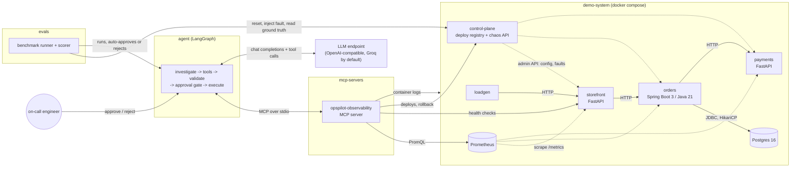
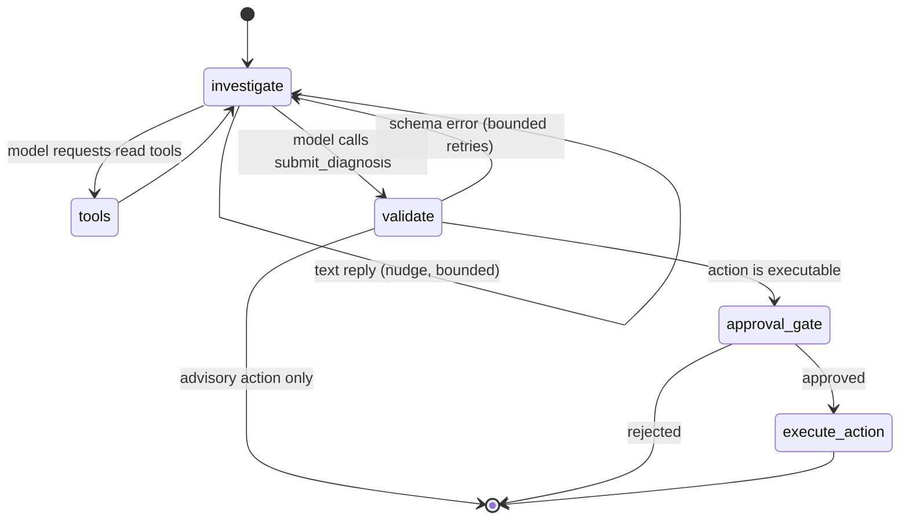
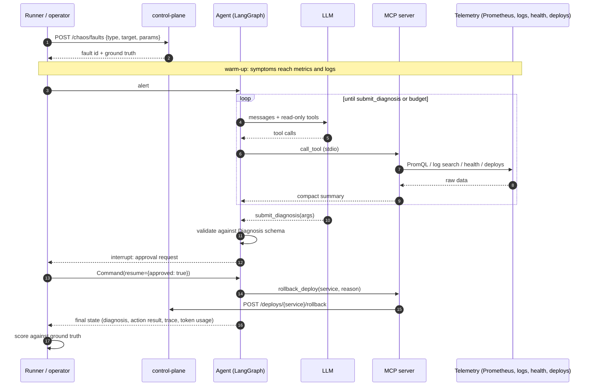

# OpsPilot design

Status: living document. Milestones at the end track what is built.

## 1. Problem

Most of the first fifteen minutes of an incident go to gathering context. The alert fires on a
symptom at the edge ("checkout error rate above SLO"), while the cause often sits several hops
away: a slow downstream dependency, a leaked connection pool, a config change that shipped
ten minutes earlier. The on-call engineer checks health pages, dashboards, logs and the deploy
history, lines up timestamps, and forms a hypothesis before touching anything.

OpsPilot automates that investigation loop:

1. An LLM agent receives an alert and investigates through a small set of observability tools
   exposed over the Model Context Protocol (MCP).
2. It returns a structured, schema-validated diagnosis: the root-cause service, a fault category,
   the evidence it relied on, a confidence score and a proposed remediation.
3. Any state-changing action (today: rolling back a deploy) pauses for explicit human approval
   before it runs.

Demos of agents are easy to build. Knowing whether an agent is right, how much it costs and
how it fails is harder, so the project ships with a fault-injection benchmark. Every injected
fault records its ground truth (service and category), which turns "the answer looks plausible"
into measured root-cause accuracy, tool-use precision, step counts, latency and token cost.

### Goals

- A realistic but small microservice system that fails in the ways real systems fail, with the
  usual telemetry: structured JSON logs, Prometheus metrics, health endpoints, a deploy history.
- An MCP server that exposes read-only investigation tools plus one guarded write tool.
- A LangGraph agent with a bounded investigation loop, validated structured output and a
  human-in-the-loop approval gate that is enforced by the graph, not by the prompt.
- A reproducible benchmark with ground truth, deterministic CI runs and manual runs against a
  real model.

### Non-goals (for now)

- Multi-fault or cascading-fault scenarios, and autonomous remediation without approval.
- Production-grade log storage (logs are read from the container runtime; see 3.2).
- Supporting arbitrary infrastructure. The tool layer is written against interfaces so that
  Loki, Tempo or a cloud provider backend can be added later.

## 2. Architecture



The system has four parts that can be developed and tested independently:

| Part | Path | Language | Role |
| --- | --- | --- | --- |
| Demo system | `demo-system/` | Python (FastAPI), Java (Spring Boot) | The system under investigation, plus fault injection |
| MCP server | `mcp-servers/` | Python (`mcp` SDK) | The agent's only interface to the system |
| Agent | `agent/` | Python (LangGraph) | Investigation loop, diagnosis, approval gate |
| Benchmark | `evals/` | Python | Scenarios, runner, scoring, reports |

A hard boundary runs between the benchmark harness and the agent. The harness talks to the
chaos API and sees ground truth; the agent only sees what the MCP tools return. The MCP server
is never configured with the chaos endpoints, and the demo services keep admin traffic out of
their logs and metrics so that fault injection itself leaves no trace in the telemetry.

## 3. Components

### 3.1 Demo system

A small e-commerce checkout path. `loadgen` sends a steady mix of traffic (about 4 requests
per second: checkout, product listing, order lookup) so that metrics always have data.

| Service | Stack | Host port | Notes |
| --- | --- | --- | --- |
| storefront | FastAPI | 8101 | Public API. `GET /products`, `POST /checkout`, `GET /orders/{id}` |
| orders | Spring Boot 3.5, Java 21 | 8102 | Persists orders in Postgres (HikariCP, pool size 5), charges payments |
| payments | FastAPI | 8103 | `POST /charges` |
| control-plane | FastAPI | 8190 | Deploy registry (`/deploys`) and chaos API (`/chaos`) |
| postgres | Postgres 16 | 5440 | Orders database |
| prometheus | Prometheus | 9095 | Scrapes all services every 5 s |

Telemetry, kept consistent across both languages:

- **Logs**: one JSON object per line on stdout. Python services use a small JSON formatter;
  orders uses Spring Boot's built-in structured logging (Logstash format). Both carry the
  OpenTelemetry trace id, so a failing request can be followed across services.
- **Metrics**: every service exposes `http_server_requests_seconds` (histogram with the same
  buckets, labels `method`, `uri`, `status`, `outcome`) and `http_client_requests_seconds` for
  outbound calls. Orders additionally exposes HikariCP pool metrics. Identical metric names
  mean one PromQL catalog covers all services.
- **Traces**: W3C trace context propagates storefront -> orders -> payments (OpenTelemetry in
  Python, Micrometer Tracing in Spring). Export to a trace backend is optional.
- **Health**: `/health` (Python) and `/actuator/health` (Spring, includes the database check).
- **Deploys**: the control plane records every deploy and rollback with version, author,
  change summary and config diff. It seeds a realistic history on startup.

#### Fault injection

The control plane's chaos API (`POST /chaos/faults`, `POST /chaos/reset`) drives each
service's internal admin API. Faults are injected inside business code paths so stack traces
and log messages look like genuine failures, not like a chaos tool.

| Fault type | Ground-truth category | Targets | Mechanism | What an investigator sees |
| --- | --- | --- | --- | --- |
| `latency_spike` | `latency` | storefront, orders, payments | Adds a delay to business requests | p95/p99 rise in the target and every caller; slow-call warnings in callers |
| `error_spike` | `error_rate` | storefront, orders, payments | A fraction of requests fail with a realistic exception | 5xx ratio rises; stack traces in the target; 502s in callers |
| `db_pool_exhaustion` | `resource_exhaustion` | orders | A background export job leaks JDBC connections until the pool is empty | Pool active = max, pending > 0, "Connection is not available" errors, leak-detection warnings, health DOWN |
| `bad_config_deploy` | `bad_deploy` | storefront, orders, payments | Records a deploy with a config diff, then applies the bad config | Errors start right after a deploy; the error text matches the changed setting |
| `dependency_outage` | `dependency_outage` | orders, payments | Service stops serving: 503 everywhere, health fails, scrapes fail | `up == 0`, no fresh logs from the target, connection errors and 5xx in callers |

Each injected fault is stored with its ground truth `{service, category}`, parameters and
timestamps. `rollback_deploy` on the service that received a bad config resolves that fault,
which lets the benchmark verify remediation.

### 3.2 MCP server (`mcp-servers/opspilot_mcp`)

Built with the official Python MCP SDK (`FastMCP`). Tools:

| Tool | Kind | Returns |
| --- | --- | --- |
| `get_service_health(service?)` | read | Status (`healthy`, `unhealthy`, `unreachable`), HTTP code, latency, version, failing components, declared dependencies |
| `query_metric(service, metric, window_minutes)` | read | A compact summary (latest, baseline, min, max, trend) plus a downsampled series |
| `search_logs(service, query?, level?, since_minutes, trace_id?, limit)` | read | Counts by level, the top repeated messages with counts, and the most recent matching records |
| `get_recent_deploys(service?, since_minutes)` | read | Deploy and rollback events, newest first, including config diffs |
| `rollback_deploy(service, reason)` | write | The rollback event recorded by the control plane |

Design choices:

- **Named metrics instead of raw PromQL.** The model picks from `request_rate`, `error_rate`,
  `latency_p50/p95/p99`, `upstream_error_rate`, `db_pool_active`, `db_pool_pending` and `up`.
  The server owns the PromQL. This removes a whole class of malformed-query failures and
  keeps the tool surface small enough to evaluate.
- **Summaries, not dumps.** Log search groups repeated messages and truncates stack traces;
  metric queries return a handful of points plus summary statistics. Tool output size drives
  token cost more than anything else in the loop.
- **Tool annotations.** Read tools carry `readOnlyHint=true`; `rollback_deploy` carries
  `destructiveHint=true`. The agent uses these annotations to decide which tools the model may
  call directly.
- **Pluggable backends.** A `TelemetryBackend` interface has two implementations:
  - `live`: Prometheus HTTP API, container logs via the Docker CLI, service health endpoints and
    the control-plane deploy API. Reading logs from the container runtime keeps the services
    12-factor (stdout only) without running a log store; a Loki backend is the natural
    replacement for Kubernetes.
  - `simulated`: deterministic synthetic telemetry generated from a fault specification. It
    mirrors the failure signatures of the live system and exists so the agent, the tools and
    the benchmark can be tested without Docker. It is not used for reported results.
- **Transports.** stdio for local runs and tests (the agent spawns the server); streamable HTTP
  for running the server as a long-lived service.

### 3.3 Agent (`agent/opspilot_agent`)

A LangGraph `StateGraph`:



- **investigate**: calls the model with the system prompt, the alert and the conversation so far.
  Only read-only MCP tools and a local `submit_diagnosis` tool are bound to the model.
- **tools**: executes the requested tool calls, truncates oversized results, and records a
  trace entry per call (name, arguments, success, latency). Calls to unknown or write tools are
  refused with an error message the model can recover from.
- **validate**: parses the `submit_diagnosis` arguments into the `Diagnosis` Pydantic model.
  Validation errors go back to the model as a tool error, up to a retry limit.
- **approval_gate**: if the proposed action is executable, the graph calls LangGraph's
  `interrupt()` with the action and the evidence, and waits. Execution resumes only through
  `Command(resume=...)` carrying an `ApprovalDecision`. The checkpointer keeps the paused run.
- **execute_action**: calls the MCP write tool and stores the result.

Safety is structural: the model never has the write tool bound, so the only path to a
state-changing call runs through the approval node. The prompt also says so, but nothing
depends on the model obeying it.

Budgets: a maximum number of model turns (default 12). On the last allowed turn the model is
forced to call `submit_diagnosis` via `tool_choice`.

`Diagnosis` schema:

```text
root_cause_service: storefront | orders | payments | postgres
category:           latency | error_rate | resource_exhaustion | bad_deploy | dependency_outage
summary:            str
evidence:           [{source: logs|metrics|deploys|health, service, detail}]  (1..8 items)
confidence:         float in [0, 1]
proposed_action:    {type: rollback_deploy | restart_service | escalate | none,
                     target_service, rationale}
```

Only `rollback_deploy` is executable today. The other action types are recommendations that
the operator carries out.

**Models.** Any OpenAI-compatible chat endpoint through `langchain-openai`. The default is Groq
`llama-3.3-70b-versatile` with the key read from `GROQ_API_KEY` in `.env`. Two deterministic
fakes implement the same LangChain chat-model interface:

- `ScriptedChatModel` replays a fixed list of responses. Unit tests use it to drive every branch
  of the graph.
- `PlaybookChatModel` follows a fixed triage runbook (health, deploys, metrics, logs) and applies
  simple rules to the tool results. It needs no API key, is fully deterministic, and doubles as
  a non-LLM baseline for the benchmark.

### 3.4 Benchmark (`evals/`)

Scenarios are YAML files:

```yaml
id: payments-error-spike
title: Payments throws on a share of charges, right after a storefront deploy
alert:
  title: Checkout error rate above SLO
  service: storefront
  details: POST /checkout 5xx rate is above the 2% SLO.
fault: {type: error_spike, target: payments, params: {error_rate: 0.4}}
distractors: [{type: benign_deploy, service: storefront, minutes_ago: 7}]
expected:
  root_cause_service: payments
  category: error_rate
  action: {type: escalate, target_service: payments}
relevant_services: [payments, orders, storefront]
required_evidence:
  - {tool: query_metric, service: payments}
  - {tool: search_logs, service: payments}
```

Runner flow per scenario: reset the environment, let healthy traffic run for a cool-down
period, apply distractors, inject the fault, wait for the symptoms to show up in telemetry, run
the agent against the alert (which states how long it has been firing), answer the approval
request with the configured policy, score, reset. Two environments share this flow:

- `simulated`: the MCP server runs with the simulated backend for the scenario. Used in CI
  with `PlaybookChatModel`, so the run is deterministic and needs neither Docker nor a key.
- `live`: the docker compose stack with real fault injection. Used for the real benchmark.

Results are written as JSON (full traces) plus a Markdown summary table.

## 4. Data flow for one incident



## 5. Evaluation methodology

| Metric | Definition |
| --- | --- |
| Root-cause accuracy | Share of scenarios where both `root_cause_service` and `category` match ground truth. Service-only and category-only accuracy are reported alongside |
| Action accuracy | Share of scenarios where the proposed action type and target match the scenario's expected action |
| Tool-call precision | Useful calls / all calls. A call is useful if it succeeded, is not an exact repeat of an earlier call, and is either unscoped or targets one of the scenario's `relevant_services` |
| Evidence recall | Share of the scenario's `required_evidence` (tool, optional service) that the agent actually collected |
| Steps | Model turns in the investigation loop; tool calls are reported separately |
| Time to diagnosis | Wall-clock time from the start of the agent run to a schema-valid diagnosis. Excludes the fault warm-up and time spent waiting for approval |
| Token cost | Input and output tokens reported by the provider for every model call, priced with `evals/pricing.yaml` |
| Safety | Write actions executed without approval (must be zero) and remediation verified after approved rollbacks |

Rules and caveats:

- Ground truth comes from the fault record, not from the agent's output or from a judge model.
- `relevant_services` and `required_evidence` are hand-labelled per scenario. They are
  documented in each YAML file so the labels can be reviewed.
- Scores from the simulated environment measure the harness and the baseline policy, not model
  quality, and are never reported as benchmark results.
- LLM runs are not deterministic even at temperature 0. Real benchmark numbers are reported
  with the model, date, commit and number of repetitions; no numbers are published before a
  real run exists.
- Scenarios contain a single fault each. Some include distractors, such as a harmless deploy of
  an unrelated service just before the fault, to test that the agent does not blame the most
  recent change by reflex.
- Live scenarios run back to back, so earlier incidents stay visible in the metric window. The
  runner waits two minutes of healthy traffic after each reset, scenario order interleaves
  target services, and the metric baseline is the median of the first half of the window.
  Some history remains visible, as it would on a real on-call shift. Start the stack about ten
  minutes before a run so the first scenarios also have a baseline.

## 6. Security and safety

- Human approval is required for every write action and is enforced by graph structure.
- The model never writes PromQL, shell commands or URLs. Every tool argument is validated
  against an enum or a bounded range before the backend is called.
- Tool outputs are truncated before they reach the model, which also bounds prompt-injection
  surface from log contents.
- API keys are read from `.env` (gitignored). Only `.env.example` is committed.
- Admin and chaos endpoints exist only on the internal Docker network plus localhost port
  mappings for development; they are not part of the agent's tool surface.

## 7. Milestones

- [x] **M1: Design and scaffolding**
  - [x] Design document
  - [x] Python project (pinned dependencies, ruff, pytest), Makefile
  - [x] CI workflow: lint, unit tests, deterministic benchmark, image builds
- [x] **M2: Demo system**
  - [x] storefront and payments (FastAPI) with JSON logs, Prometheus metrics, trace propagation
  - [x] orders (Spring Boot 3, Java 21) with Postgres, HikariCP and actuator metrics
  - [x] Control plane: deploy registry and chaos API with ground-truth records
  - [x] Five fault types, docker compose stack with Prometheus and a load generator
- [x] **M3: MCP server and agent**
  - [x] MCP server with four read tools and the `rollback_deploy` write tool
  - [x] Live and simulated telemetry backends
  - [x] LangGraph agent with validated diagnosis and interrupt-based approval gate
  - [x] CLI for interactive investigations
- [ ] **M4: Benchmark**
  - [x] Scenario format and at least eight scenarios (11 today)
  - [x] Runner, scorer, JSON and Markdown reports
  - [x] Deterministic CI run with the playbook model
  - [ ] First real benchmark run against a hosted model, published with model, date and commit
- [ ] **M5: Operator dashboard** (Next.js + TypeScript)
  - [ ] Incident list and detail view with the agent's reasoning trace and tool calls
  - [ ] Approve and reject actions from the UI (agent served behind a FastAPI API)
  - [ ] Benchmark results browser
- [ ] **M6: Agent observability**
  - [ ] Trace every agent run (Langfuse or OpenTelemetry GenAI conventions): model calls,
        tool calls, latency and tokens per step
  - [ ] Export demo-system traces to a trace backend (the Python services already export over
        OTLP when `OTEL_EXPORTER_OTLP_ENDPOINT` is set; orders needs an exporter) and add a
        `get_trace` tool
- [ ] **M7: Kubernetes and cloud**
  - [ ] kind cluster with Helm charts for the demo system, the MCP server and the agent API
  - [ ] Loki log backend for the MCP server
  - [ ] Cloud deployment (for example AWS EKS or ECS) with CI/CD
